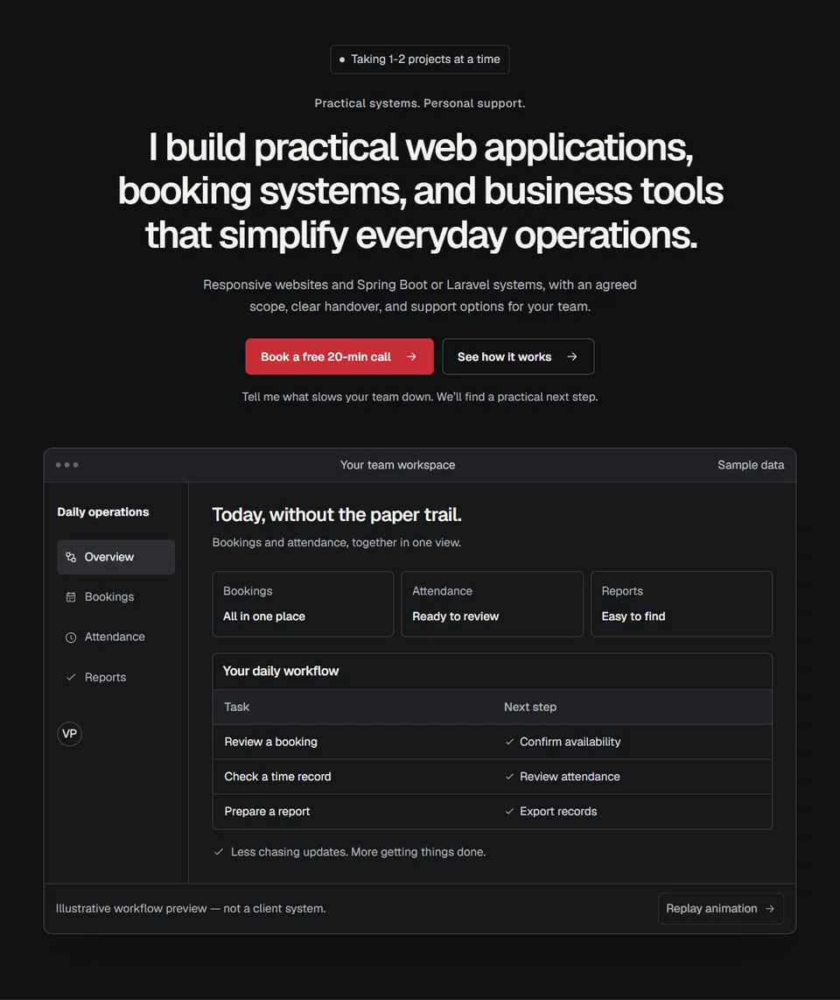
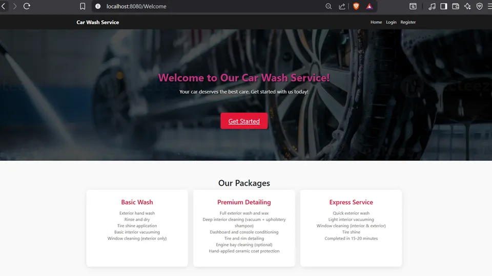

# Vincent Gabrielle Pimentel

I build booking, attendance, and workflow systems that replace paperwork for schools and small businesses.

[View my portfolio](https://dcane4ever.github.io/my-portfolio/) · [Email me about your project](mailto:vincentgabriellepimentel@gmail.com)



## See how I approach your project

This is my portfolio site. It shows my services, project interfaces, pricing, and the steps I take from a first conversation to launch. I built it with the same attention to clear screens and practical communication that I bring to business tools. You can judge the site itself on your phone, try the contact flow, and decide whether my approach fits your team.

## Make everyday work easier

These services are intended for schools and small businesses. The examples below describe who a system could help; they are not claims that I have already worked with every industry listed.

- **Booking and reservation systems:** For schools and appointment-based businesses that need availability, bookings, and staff controls in one place. Planning estimate: 3–6 weeks for a focused first version.
- **Attendance and DTR systems:** For administrators tracking staff time. Daily time records, supervisor review, and useful attendance reports. Planning estimate: 4–8 weeks, depending on your rules.
- **Admin dashboards and workflow automation:** For teams repeating the same admin tasks. Track requests, roles, statuses, and approvals without copying information between spreadsheets. Planning estimate: 3–8 weeks for an agreed workflow.

The site also lists introductory website packages starting at **₱4,999** and custom-system estimates starting at **₱12,000**. I confirm the actual scope, price, and schedule with you before work starts.

## A site you can use with confidence

| What matters to you              | How this site handles it                                                                                                                                             |
| -------------------------------- | -------------------------------------------------------------------------------------------------------------------------------------------------------------------- |
| Fast to open on a phone          | Complete page content is prepared in advance. Photos and screenshots use optimized WebP files, and lower-page images load when needed. The font is included locally. |
| Easy to navigate                 | Clear headings, keyboard controls, visible focus outlines, labeled form fields, and accessible FAQ controls.                                                         |
| Comfortable on different screens | Browser checks cover 375px phones, 768px tablets, and 1280px desktops, including horizontal overflow.                                                                |
| Easy to find and share           | A descriptive title, search description, social preview image, structured information for search engines, and a sitemap.                                             |
| A clear way to contact me        | The form checks your answers and prepares an email draft. Open that draft and press Send in your email app. A direct email link is always available.                 |
| Motion that stays useful         | The hero animates on page entry. Other sections reveal as you scroll. Reduced-motion preferences stop the effects, and content remains readable without JavaScript.  |
| Privacy by default               | Analytics are off by default. Preparing an inquiry does not automatically transmit it.                                                                               |

**Measured locally on October 12, 2026:** mobile Lighthouse scored **100 Performance, 100 Accessibility, 100 Best Practices, and 100 SEO**, with **zero measured layout shift**. Lighthouse is an automated browser check; these are local lab results, not a guarantee of identical results on every device or connection.

## Under the hood

The technical choices support a simple client experience: readable pages, reusable sections, and content that stays consistent.

<details>
<summary>Details for your technical reviewer</summary>

- **React 18 and JSX:** Reusable page sections keep shared controls consistent.
- **Tailwind CSS and custom CSS:** A shared type scale, colors, spacing, and responsive layout.
- **esbuild and React server rendering:** Compile production JavaScript and prepare complete HTML before the browser opens the site.
- **Sharp:** Produces optimized WebP photos and screenshots with explicit dimensions.
- **GSAP, ScrollTrigger, and the React GSAP hook:** Scope motion to the relevant elements and clean it up when reduced motion is enabled. ScrollTrigger starts a reveal when an element reaches the viewport.
- **CSS entrance animations:** Start the navigation and hero at first paint, without waiting for the React bundle.

Key source areas:

```text
js/       Page sections, content settings, and motion
css/      Shared styles and original project images
assets/   Optimized photos, screenshots, and sharing image
scripts/  Page rendering, asset processing, and checks
```

`js/content.js` contains public copy, contact values, prices, project information, and optional integrations. The build reads the same data for rendered HTML, metadata, and structured data describing a Person and ProfessionalService. React then attaches interactive controls to the rendered page.

`js/motion.js` controls the section reveals. The workspace keeps its own short workflow sequence and Replay animation control. Motion runs on entry or when content reaches the viewport; it does not loop automatically. Resize handling keeps the reveal positions accurate when an FAQ opens or a form changes. Keyboard focus reveals the relevant section immediately.

Content checks reject unfinished copy, validate generated assets, and exercise inquiry validation. Browser checks cover navigation, keyboard access, FAQ behavior, pricing, responsive layouts, email preparation, reduced motion, and page entrances. Optional form-endpoint success and failure are tested with mocked requests; no real inquiries are sent during those tests. Lighthouse measures mobile performance and accessibility.

The form also has a hidden spam field. Its current implementation prepares email rather than submitting to a server, so the success message says that a draft is ready. With JavaScript disabled, the page offers a direct email fallback.

</details>

## Know what happens next

1. **Discovery call:** We spend 20 minutes discussing your current process, your team, and what needs to change.
2. **Fixed-scope proposal:** You receive a written scope, price, timeline, and deliverables before work begins.
3. **Build with weekly demos:** You see progress, try the workflow, and give feedback while it is being built.
4. **Launch and support:** I help with launch and team training, then provide the support agreed in your proposal.

The proposal sets out code ownership, source-code handover, included revisions, and the support window. If a request changes the agreed scope, I explain the effect on price and timing before doing it. I reply within 24 hours.

## Selected work

These are project interface previews. The hotel work is explicitly a prototype. They are not client endorsements or evidence of live operation.

- **DTR Supervisor and Workflow System — attendance interface preview.** Saved screens show supervisor and employee views, time-in controls, schedules, and links to time-record requests and print summaries.
- **Pearl Manila Hotel Booking prototype — booking UX prototype.** The saved page shows hotel information, amenities, and navigation for rooms, facilities, check-in, and login.
- **Car Wash Management System — website interface preview.** Saved screens show service-package descriptions, sign-in, and account-registration interfaces.



## Work directly with someone who understands support

- My customer and tech support background shapes how I explain problems in plain language.
- I focus on clear screens and workflows that non-technical staff can use.
- I agree on scope and deliverables in writing before work starts.
- You work directly with me, with regular opportunities to review progress and give feedback.

## Let’s talk about your project

[Email me](mailto:vincentgabriellepimentel@gmail.com) with the process you want to improve, who will use the system, and your preferred deadline. A rough idea or a spreadsheet is enough to start the conversation. I reply within 24 hours.

You can also [visit the portfolio](https://dcane4ever.github.io/my-portfolio/) to compare packages or prepare an inquiry email.

[GitHub](https://github.com/Dcane4ever) · [LinkedIn](https://www.linkedin.com/in/vincent-pimentel-6986b726b/)

<details>
<summary>Run it locally</summary>

```sh
npm install
npm run dev
```

</details>

© 2026 Vincent Gabrielle Pimentel.
